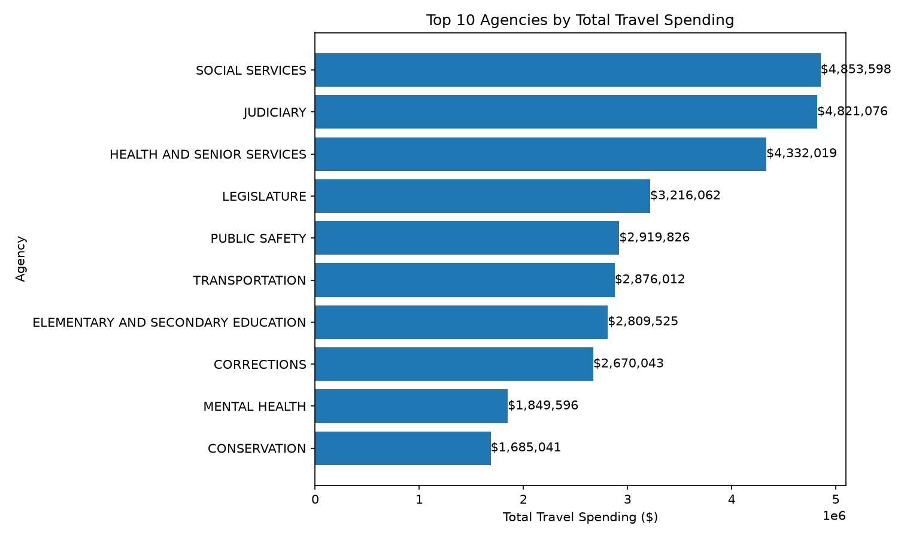

# Missouri Travel Expenditure Signal Design

Continuous Intelligence | Project 03 | Custom Application

## Overview

This project uses Missouri State Expenditures data to create signals
for monitoring travel spending and identifying unusual spending patterns.

The goal is to transform raw travel expenditure data into useful signals
that make spending patterns easier to understand and compare across agencies.

## Data

The source data is available from the
[Missouri State Expenditures Data](https://data.mo.gov/Government-Administration/2026-State-Expenditures/gndj-tfr3/about_data)
on the Missouri Data Portal.

The original dataset contains 102,540 expenditure records.
The project filters the data to the TRAVEL category,
resulting in 37,402 travel expenditure records.

The analysis uses information such as:

- `Agency Name` - the state agency responsible for the expenditure.
- `Category Description` - the expenditure category.
- `Detail Description` - additional information about the type of expense.
- `Vendor Name` - the vendor or payee.
- `Payments Total` - the original payment amount.
- `payment_amount` - the numeric version of the payment amount used for calculations.

The source data is available from the Missouri Data Portal.

## Methods

The project creates signals from Missouri travel expenditure data
to make spending patterns easier to monitor and compare.

### Payment Amount

The original `Payments Total` field is converted from text
to a numeric value called `payment_amount`.

This allows the travel expenditures to be used in calculations.

### Agency Average Travel Spending

The project calculates the average travel payment for each agency.

    agency_avg_travel = average payment amount for the agency

This provides a baseline for comparing individual travel payments
with typical spending for that agency.

### Relative to Agency Average

Each travel payment is compared with its agency's average travel payment.

    relative_to_agency_avg = payment_amount / agency_avg_travel

A value of `1.0` is equal to the agency average.
A value greater than `1.0` is above the agency average.

For example, a value of `5.0` means the payment is five times
the agency's average travel payment.

### Agency Summary

The project also summarizes travel activity by agency using:

- total travel spending
- average travel payment
- number of travel payments

These measures provide additional context for comparing travel
spending across Missouri state agencies.

## Results

The project processed 37,402 Missouri travel expenditure records
and created signal values for each record.

The agency summary showed that the three agencies with the highest
total travel spending were:

| Agency | Total Travel Spending |
|---|---:|
| Social Services | $4,853,598 |
| Judiciary | $4,821,076 |
| Health and Senior Services | $4,332,019 |

Social Services had the highest total travel spending,
with Judiciary close behind.

The signals also provide another way to examine individual payments.
For example, an Agriculture travel payment of $121,036.78 was about
114 times the average travel payment for that agency.

### Travel Spending by Agency

The following chart shows the top 10 agencies by total travel spending.

The complete signal results are saved in
`artifacts/missouri_travel_signals.csv`.

## Technical Experiment

I added an `error_rate_pct` signal to display the error rate as a percentage
instead of only as a decimal.

I chose this modification because percentages are easier to read and interpret.

I predicted that an error rate of `0.025` would be displayed as `2.5%`.

After running the pipeline, the new `error_rate_pct` column was created
successfully. For example, an `error_rate` of `0.025` produced an
`error_rate_pct` of `2.5`.

This experiment showed that a derived signal can present the same data
in a format that is easier to understand and interpret.

## Interpretation

The results show that looking at more than one signal provides
a better understanding of Missouri travel spending.

Total travel spending identifies which agencies have the highest
overall spending, while the agency average provides a baseline
for typical travel payments within each agency.

The `relative_to_agency_avg` signal helps identify individual payments
that are unusually large compared with other travel payments
for the same agency.

Together, these signals provide more context than looking
at the raw payment amounts alone.

## Limitations

Agency averages can be affected by unusually large or small payments,
so they may not always represent typical travel spending.

The analysis also does not account for differences in agency size,
number of employees, or travel needs.

These signals can identify spending patterns that may deserve
further review, but they do not determine whether an expenditure
is appropriate or inappropriate.

## Conclusion

This project demonstrates how Missouri travel expenditure data
can be transformed into useful monitoring signals.

Using total spending, agency averages, and relative payment values
provides different views of the data and makes unusual spending
patterns easier to identify and investigate.

## Next Steps

Future analysis could compare travel spending across fiscal years
to identify changes and trends over time.

Additional signals could also consider agency size, number of employees,
or travel activity to provide more context when comparing agencies.

## Documentation Index

- **Home** - this landing page
- [**Project Instructions**](project-instructions.md)
- [**Glossary**](glossary.md)
- [**API**](api.md)
- [**Reactive App**](./app/index.html)

## Project Links

- [GitHub Repository](https://github.com/Angie-Crews/cintel-03-signal-design)
- [Custom Travel Signal Pipeline](https://github.com/Angie-Crews/cintel-03-signal-design/blob/main/src/cintel/travel_signal_design.py)
- [Results and Artifacts](https://github.com/Angie-Crews/cintel-03-signal-design/tree/main/artifacts)
- [Missouri State Expenditures Data](https://data.mo.gov/Government-Administration/2026-State-Expenditures/gndj-tfr3/about_data)
- [Project Instructions](project-instructions.md)

## Project Resources

- [Project Instructions](project-instructions.md)
- [Professional Python Guide](https://denisecase.github.io/pro-analytics-02/)
- [Professional Python Project Explainer](https://pup-pack.github.io/professional-python-project-explainer/).
- [Suggested Datasets](https://denisecase.github.io/pro-analytics-02/reference/datasets/cintel/)
